<!-- Banner -->

<h1 align="center">Hi 👋, I'm Firas Alzarouq</h1>
<h3 align="center">Network & Telecommunication Engineer | Infrastructure Specialist | Libya 🇱🇾</h3>

---

- 💼 I work as an **Infrastructure Specialist**
- 🌱 I'm currently learning **AI, Kubernetes & Orchestration**
- 💬 Ask me about **Python, Linux, Docker, Kubernetes**
- 📫 How to reach me: **[Firasalzarouq@gmail.com](mailto:Firasalzarouq@gmail.com)**
- ⚡ Fun fact: **I don't bite, ask me anything!**

### 🌐 Connect with me:

### 🛠️ Languages and Tools:

### 📊 GitHub Stats:

<!-- Footer -->

